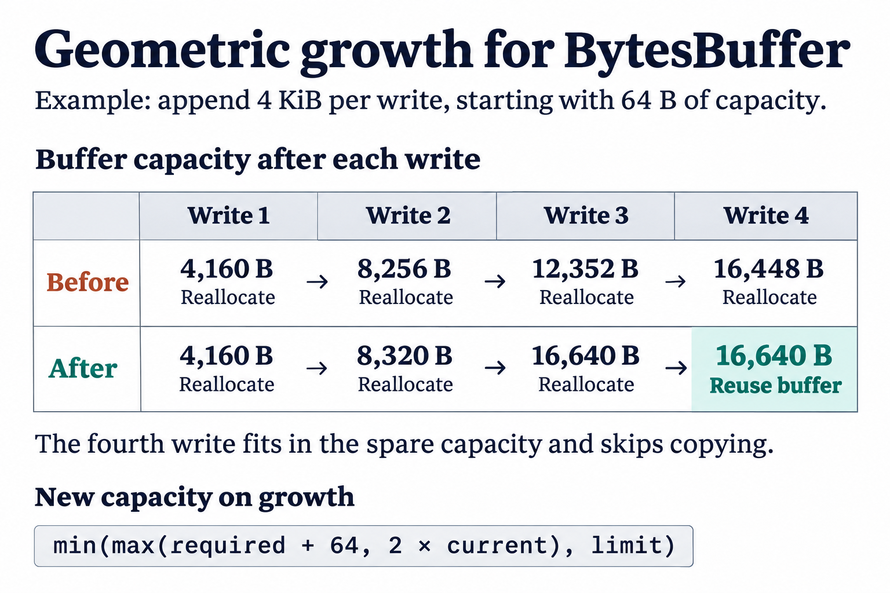
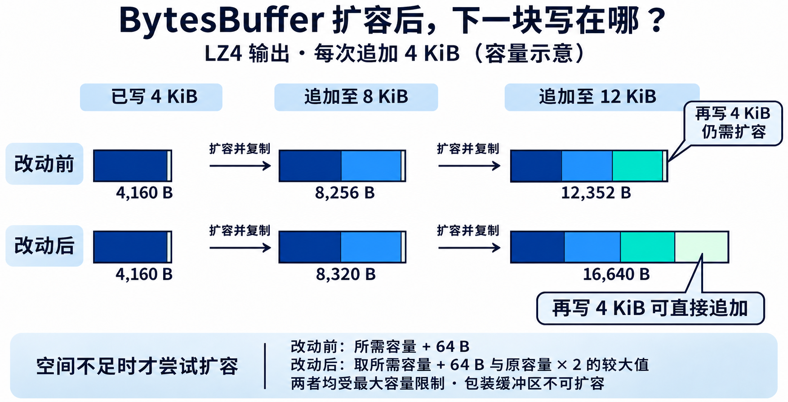
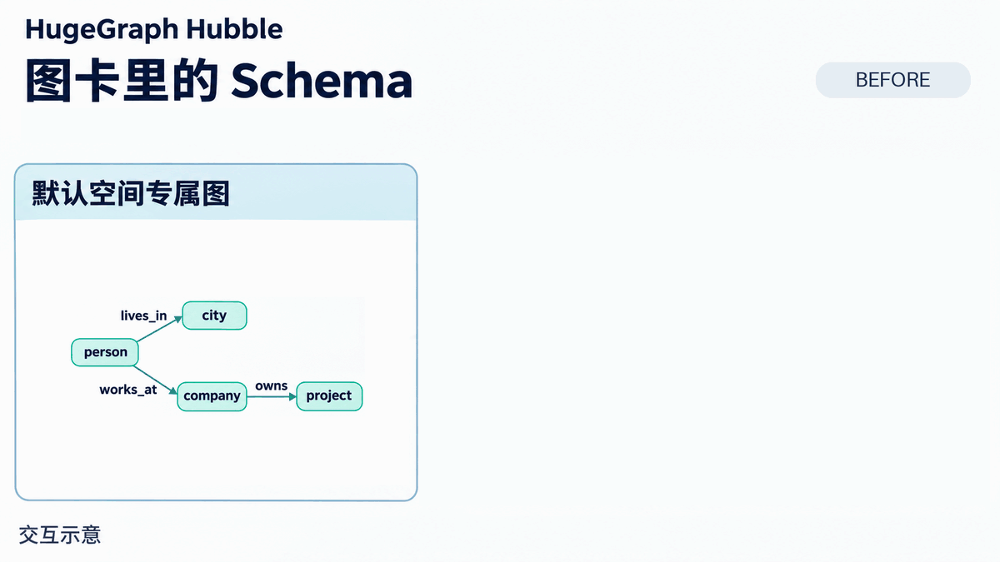

# Codex imagegen 的技术改动配图扩展

把这份参考指南接入现有 `imagegen`，就能用同一个入口给 PR、MR、本地提交或工作区改动配图。

[核心功能](#核心功能) · [效果对比](#效果对比) · [安装](#安装) · [使用与验证](#使用与验证)

## 核心功能

- **把改动画出来。** 根据实际代码差异和相关测试，用对象、关系或状态解释机制。出图后逐张核对数字，也检查长度、位置和连线实际表达的关系。
- **按内容选择静态图或 GIF。** 自动判断时序和状态变化是否适合播放，也支持明确要求 GIF。按客户端能力原生生成或本地组帧，交付前核对帧序、停留时间和循环。
- **试用阶段默认生成并展示两张，方便比较。** 同一份生图提示独立跑两次，能并行就并行。两张会讲同一套内容，画面细节可能不同。逐张核对事实后，把 A、B 一起发给你选。需要推荐时再请评审比较。正式版可能改回默认一张。试用期间想只收一张，可以直接说「只给我一张」。

## 效果对比

### 静态图 · 缓冲区扩容

同一缓冲区扩容 PR 的两次实测配图。点击图片可查看大图。 [查看 PR](https://github.com/apache/hugegraph/pull/3390)

| 使用前 · 当时的默认配置 | 使用后 · 接入 PR 配图指南 |
| --- | --- |
| [](../../assets/bytesbuffer-before.png) | [](../../assets/bytesbuffer-after.png) |
| 从容量数字和状态找出第四次写入的差异。 | 从浅色余量看出第四个 4 KiB 数据块为什么可以直接追加。 |

### GIF · 展开 Schema 卡片

改动前，完整关系挤在卡片缩略图里。改动后，顶点类型和边类型合计超过 6 种时，卡片先显示类型摘要，点开后再看完整关系。下面的 GIF 用同一张图演示三个状态，由本地组帧并验证过循环播放。 [查看 PR](https://github.com/apache/hugegraph-toolchain/pull/874)



## 安装

试用指南跟随 `master` 分支。在支持内置生图的 Codex 客户端里，把下面整段贴给 Codex。扩展装在用户技能目录，内置技能由 Codex 管理。 [Codex 技能配置](https://learn.chatgpt.com/docs/build-skills#enable-or-disable-local-codex-skills)

```text
请一次装好 HugeGraph 的技术改动配图扩展。安装后仍用 imagegen 这一个入口。

先查当前 Codex 的技能列表和配置，确认内置 imagegen 的真实路径、可加载的用户技能目录及所有同名条目。若只有内置版，把完整目录复制到当前客户端支持的用户技能目录（例如 ~/.agents/skills/imagegen 或 Codex 用户目录下的 skills/imagegen），保留通用生图流程和资源。旧版扩展曾写入内置目录时也按这个方式迁移，保留内置目录原样，在用户版更新旧引用。已有这份扩展的用户版就原地更新。若发现其他同名版本、无法辨认的自定义内容，或待写入的技能目录或文件通过符号链接指向别处，先列出来等我确认。

先从 https://raw.githubusercontent.com/hugegraph/skills/master/extensions/imagegen/technical-visuals.md 读到完整指南，再保存为用户版的 references/technical-visuals.md。在用户版 SKILL.md 添加或更新一条引用，遇到 PR、MR、本地提交或工作区改动配图时，先读指南并执行默认双候选流程。一次流程默认用同一份生图提示生成两张并一起展示，无法并行就改为串行。只有用户要求评价或推荐时才调用比较评审。

在用户 config.toml 中用 [[skills.config]] 把内置版 SKILL.md 的绝对路径设为 enabled = false。确认最后一条匹配规则确实停用这个路径，已生效的等效条目可以复用。若这份扩展的用户版此前已按路径停用，恢复该路径的启用状态。保留 .system 文件和其他配置。

跳过备份文件。写入前验证准备好的文件与配置，并在本次执行中保留要改动的原值，便于撤销。用重新加载配置的 Codex 核对技能列表，确认只有用户版 imagegen 已启用，引用能打开，其他技能保持原来的启用状态。若只是当前桌面仍用旧配置，告诉我退出并重开，标明待验证。确有写入或配置错误时，撤销本次改动并报告原因。核查通过后，列出用户版路径、停用的内置路径和恢复方法。
```

## 使用与验证

退出并重开 Codex，再开新会话。在 `@` 或 `$` 的技能选择器里确认只有一个可用的 `imagegen`。复制下面这行，用上方效果对比中的同一个 PR 试出图。

```text
给 https://github.com/apache/hugegraph/pull/3390 配图，让人容易理解这个 PR 的改动。
```

看图时检查能否分辨两种扩容规则，能否看出新策略如何预留空间、减少后续复制。新策略在「所需容量 + 64 B」和「原容量 × 2」之间取较大值，再受原有最大容量约束。同一条回复应展示 A、B 两张。若只展示一张，回复应交代实际生成的张数和另一张未能交付的原因。

在本地仓库里也可以直接说：

```text
把当前分支最近 3 个提交提炼成图，让人看懂这些提交合起来改变了什么。
```

MR 可以直接给链接。也可以明确要求 GIF。

```text
给 https://github.com/apache/hugegraph-toolchain/pull/874 配一个 GIF，让人看懂 Schema 卡片如何从摘要展开完整关系。
```

隔离环境已验证用户版在桌面随附运行时和独立 CLI 交替启动后仍是唯一启用的 `imagegen`，也核对了恢复内置版后的技能登记。实际客户端的选择器和出图按上面的步骤验证。

## 更新与恢复

想更新指南时，重新使用本页的安装 Prompt，从 `master` 取当前版本。升级 Codex 后可重新核对唯一启用的入口和指南引用。

要切回内置版，让 Codex 按路径停用试用用户版，并恢复内置路径的启用状态，再退出并重开 Codex，确认只有内置 `imagegen` 启用。安装过程中若遇到错误，用本次保留的原值撤销改动。原来已有的自定义版本按原配置处理。

[飞书使用说明与实测](https://hugegraph.feishu.cn/wiki/Q0QvwxE3CiccVOkHYxEceFLqn5b) · [来源与实测范围](PROVENANCE.md) · [仓库索引](../../README.md)
